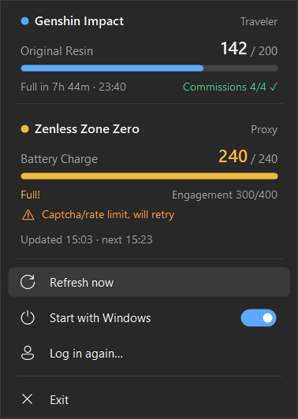
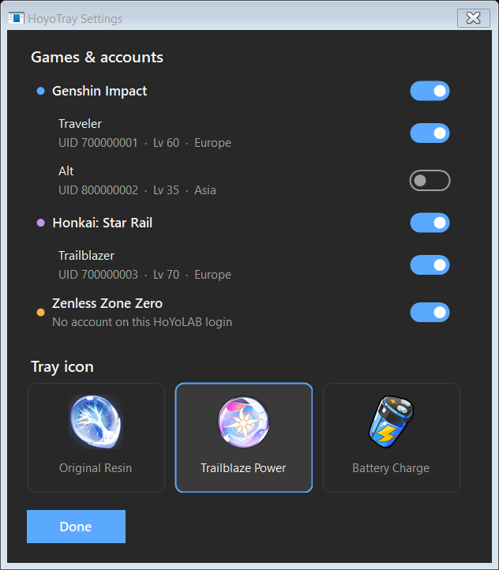

# HoyoTray

[](../../releases/latest)
[](../../releases)
[](LICENSE)


A tiny Windows system-tray app that shows your **Genshin Impact Original Resin**,
**Honkai: Star Rail Trailblaze Power** and **Zenless Zone Zero Battery Charge**,
pulled from HoYoLAB's Real-Time Notes (daily notes).

A lightweight resin tracker and stamina reminder for your desktop: see at a glance how much
resin, trailblaze power or battery you have and exactly when it caps, without opening
the HoYoLAB app or a game launcher.

Hover the icon for a quick glance, or left/right-click for the full card:



## Features

- Resin, Trailblaze Power and battery with progress bars, "full in" countdown and the clock time it caps
- Genshin commissions, HSR daily training and ZZZ engagement at a glance
- Settings window to choose which games are shown, show several accounts per game,
  and pick the tray icon (Original Resin, Trailblaze Power or Battery Charge)
- Polls HoYoLAB every 20 minutes (and after waking from sleep); counts regen locally in between,
  so numbers stay accurate to the minute without hammering the API
- One-time login through an embedded HoYoLAB page, no copying cookies by hand
- Follows the Windows light/dark theme
- "Start with Windows" toggle
- ~2 MB single exe

## Install

1. Download `HoyoTray.exe` from the [latest release](../../releases/latest).
2. Run it. If Windows asks for the **.NET 8 Desktop Runtime**, install it
   ([download](https://dotnet.microsoft.com/download/dotnet/8.0), "Desktop Runtime").
3. Log in to HoYoLAB in the window that opens. It closes by itself once your login works.
4. In HoYoLAB → Battle Chronicle → settings, make sure **Real-Time Notes** is enabled for each game.

## Settings

Click the tray icon → **Settings…**



- Toggle whole games on or off. Disabled games aren't requested from HoYoLAB at all.
- Every account linked to your HoYoLAB login is listed under its game. By default only the
  highest-level account per game is shown; switch on any others you want to see.
- Pick the tray icon.

Settings are saved in `%LOCALAPPDATA%\HoyoTray\settings.json`.

Windows SmartScreen may warn about an unrecognised app because the exe isn't code-signed.
The exe is built from this repo's source by GitHub Actions (see `.github/workflows/build.yml`),
so you can check exactly what went into it, or build it yourself.

## Build from source

Requires the [.NET 8 SDK](https://dotnet.microsoft.com/download/dotnet/8.0).

```
dotnet publish -c Release -o publish
```

The exe ends up in `publish\HoyoTray.exe`.

## Privacy

- Your HoYoLAB login cookies are stored only on your PC, encrypted with Windows DPAPI
  (readable only by your Windows user), in `%LOCALAPPDATA%\HoyoTray`.
- They're sent only to HoYoLAB's own servers. Nothing else is contacted.
- To log out completely, exit the app and delete `%LOCALAPPDATA%\HoyoTray`.
- The last fetched numbers are cached in `cache.json` (same folder) so they show instantly on launch.
  It holds only stamina values, nicknames and UIDs.
- A small troubleshooting log (`log.txt`, same folder) records refresh results and error codes.
  It never contains your cookies.

## Limitations

- Uses HoYoLAB's **unofficial, undocumented** API (the same one community tools like genshin.py
  use). HoYoverse can change it at any time, which may break the app until it's updated.
- Read-only: it never changes anything on your account and doesn't touch the game client.
- Global (HoYoLAB) servers only, not China (miyoushe) servers.

## Disclaimer

Not affiliated with or endorsed by HoYoverse. Genshin Impact, Honkai: Star Rail, Zenless Zone Zero
and related names and artwork are trademarks and copyrights of HoYoverse. The icons in `Assets/`
are HoYoverse artwork and are **not** covered by this project's license.

## License

The source code is released under the [0BSD license](LICENSE): do whatever you want with it,
no attribution required, no warranty.
